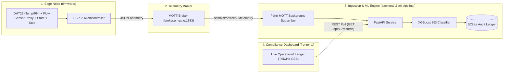

# SanMist Platform (`MistSan`)

**IoT-Enabled Automated Dry-Fog Sanitization, Regulatory Compliance Monitoring, and Machine Learning Efficacy Grading System**

[](https://www.officialgazette.gov.ph/)
[](./firmware)
[](./backend)
[](./ml-pipeline)
[](./frontend)

---

## What Is SanMist?

**SanMist (`MistSan`)** is an end-to-end IoT and Machine Learning platform designed to automate, verify, and log dry-fog sanitization in commercial food-service Back-of-House (BOH) prep areas.

In commercial kitchens, manual sanitization is difficult to standardize and audit. SanMist addresses this by connecting an **ESP32 edge controller** to a **FastAPI + XGBoost compliance engine** and a **live web dashboard**:

1. **Automate:** An ESP32 controller runs timed dry-fog misting cycles with a pre-cycle audible warning, live temperature/humidity/flow sensing, and a hardware-interrupt Emergency Stop (`E-STOP`).
2. **Stream:** Cycle telemetry is published as JSON over **MQTT** (`broker.emqx.io`) to the backend ingestion service.
3. **Evaluate:** Each cycle is scored using the empirical **Saturation Efficiency Index (SEI)** and graded by a **3-class XGBoost classifier** (`Pass`, `Marginal`, or `Fail`).
4. **Audit:** Results are persisted to a **SQLite audit ledger** and surfaced on a real-time operational dashboard aligned with Philippine sanitation and food safety standards:
   - **Presidential Decree No. 856 (PD 856):** Code on Sanitation of the Philippines
   - **Republic Act No. 10611 (RA 10611):** Food Safety Act of 2013

---

## System Architecture



---

## Key Features

- **Automated Edge Sanitization Control:** ESP32-driven misting sequence with pre-cycle buzzer warning, real-time flow-rate sampling (potentiometer proxy for a YF-S401 flow sensor), DHT22 ambient temperature/humidity sensing, and a hardware-interrupt Emergency Stop (`E-STOP`) safety interlock.
- **Saturation Efficiency Index (SEI) & ML Grading:** Evaluates each cycle across five physical parameters (`ambient_temp_c`, `relative_humidity_pct`, `flow_rate_ml_min`, `cycle_duration_sec`, `room_volume_m3`) and classifies efficacy into **Fail (`0`)**, **Marginal (`1`)**, or **Pass (`2`)**.
- **Dual Ingestion Modes:** Accepts device telemetry asynchronously via MQTT (`sanmist/devices/+/telemetry`) as well as synchronously over HTTP (`POST /api/v1/telemetry/evaluate`).
- **Real-Time Operational Ledger:** Responsive dark-mode compliance dashboard displaying live station metrics, SEI scores, safety interlock status, and historical audit records.

---

## Repository Structure

```text
sanmist-platform/
├── backend/
│   └── app/
│       └── main.py                              # FastAPI service, MQTT subscriber, ML inference & SQLite audit ledger
├── firmware/
│   ├── src/
│   │   └── main.cpp                             # ESP32 Arduino firmware (DHT22, flow proxy, E-Stop ISR, MQTT client)
│   ├── diagram.json                             # Wokwi hardware simulation schematic
│   ├── platformio.ini                           # PlatformIO build & library configuration
│   └── wokwi.toml                               # Wokwi simulator binary mapping
├── frontend/
│   └── index.html                               # Live compliance & telemetry dashboard (Tailwind CSS + Vanilla JS)
├── ml-pipeline/
│   ├── datasets/
│   │   └── sanmist_telemetry_synthetic.csv      # 2,000-sample synthetic BOH telemetry dataset
│   ├── models/
│   │   └── xgboost_sei_classifier.pkl           # Pre-trained 3-class XGBoost model artifact
│   ├── generate_dataset.py                      # Synthetic telemetry & SEI ground-truth generator
│   └── train_model.py                           # XGBoost training & evaluation pipeline
├── requirements.txt                             # Python & PlatformIO dependencies
└── README.md                                    # Project documentation
```

---

## Saturation Efficiency Index (SEI) & ML Classification

The platform quantifies dry-fog saturation using the empirical **Saturation Efficiency Index (SEI)**, which measures the disinfectant mist volume delivered per cubic meter of room volume adjusted for ambient relative humidity:

$$\text{SEI} = \left( \frac{Q_{\text{flow}} \times \frac{t_{\text{cycle}}}{60}}{V_{\text{room}}} \right) \times \left( 1 - \frac{\text{RH}}{150} \right)$$

Where:
- $Q_{\text{flow}}$ = Disinfectant flow rate ($\text{mL/min}$)
- $t_{\text{cycle}}$ = Active misting cycle duration ($\text{seconds}$)
- $V_{\text{room}}$ = Target kitchen zone volume ($\text{m}^3$)
- $\text{RH}$ = Ambient relative humidity ($\%$)

### Efficacy Classification Tiers

| Class ID | Label | SEI Threshold | Compliance Status | Description |
| :---: | :--- | :--- | :--- | :--- |
| `2` | **Pass** | $\text{SEI} \ge 4.500$ | `AUDIT_VERIFIED` | Effective dry-fog saturation achieved |
| `1` | **Marginal** | $2.800 \le \text{SEI} < 4.500$ | `REQUIRES_ATTENTION` | Sub-optimal saturation; re-sanitization advised |
| `0` | **Fail** | $\text{SEI} < 2.800$ *(or E-Stop)* | `REQUIRES_ATTENTION` | Under-saturated cycle or hardware safety halt |

---

## Getting Started

### Prerequisites

- **Python** 3.10+
- **PlatformIO** (included in `requirements.txt`, or via the VS Code extension) & **Wokwi for VS Code** (for firmware simulation)
- A modern web browser

### 1. Set Up Python Environment

From the repository root, create and activate a virtual environment, then install dependencies from `requirements.txt`:

```powershell
python -m venv .venv
.\.venv\Scripts\Activate.ps1

pip install -r requirements.txt
```

### 2. Generate Dataset & Train the ML Model *(Optional)*

A pre-trained model is already committed at `ml-pipeline/models/xgboost_sei_classifier.pkl`. To regenerate the 2,000-sample synthetic dataset and retrain the classifier:

```powershell
cd ml-pipeline
python generate_dataset.py
python train_model.py
cd ..
```

### 3. Run the FastAPI Backend & MQTT Subscriber

Start the backend server from the **repository root**:

```powershell
uvicorn backend.app.main:app --reload --host 0.0.0.0 --port 8000
```

Once running:
- **Interactive API Docs (Swagger UI):** http://localhost:8000/docs
- **Health Check:** http://localhost:8000/
- **MQTT Listener:** Automatically subscribes to `sanmist/devices/+/telemetry` on `broker.emqx.io:1883`
- **Audit Database:** Creates and writes to `backend/app/sanmist_audit.db` automatically

### 4. Launch the Compliance Dashboard

Serve `frontend/index.html` via a local static file server (or open it directly in a browser):

```powershell
python -m http.server 3000 --directory frontend
```

Navigate to http://localhost:3000 to view the live operational ledger (polls `http://localhost:8000/api/v1/records` every 3 seconds).

### 5. Build & Simulate the ESP32 Firmware

1. Open the `firmware/` directory in VS Code with the **PlatformIO** and **Wokwi** extensions installed.
2. Build the firmware binary:
   ```powershell
   cd firmware
   pio run
   ```
3. Open `firmware/diagram.json` and start the **Wokwi Simulator** to connect to `Wokwi-GUEST` Wi-Fi and publish cycle telemetry to `broker.emqx.io`.

---

## API Reference

### `GET /`
Returns service health and verifies whether the XGBoost model artifact is loaded in memory.

**Sample Response:**
```json
{
  "status": "online",
  "service": "MistSan Compliance API",
  "model_loaded": true
}
```

### `POST /api/v1/telemetry/evaluate`
Evaluates a sanitization cycle payload using the XGBoost classifier, calculates the SEI score, and persists the audit record to SQLite.

**Sample Request Payload:**
```json
{
  "station_id": "MIST-BOH-01",
  "ambient_temp_c": 27.5,
  "relative_humidity_pct": 62.0,
  "flow_rate_ml_min": 42.0,
  "cycle_duration_sec": 180.0,
  "room_volume_m3": 20.0,
  "delivery_confirmed": true,
  "estop_triggered": false
}
```

**Sample Response:**
```json
{
  "cycle_id": 1,
  "timestamp": "2026-10-29T15:00:00.000000Z",
  "station_id": "MIST-BOH-01",
  "sei_score": 3.696,
  "predicted_class": 1,
  "efficacy_label": "Marginal",
  "compliance_status": "REQUIRES_ATTENTION"
}
```

### `GET /api/v1/records?limit=20`
Returns the most recent sanitization cycle records from the SQLite audit ledger (`sanmist_audit.db`), ordered newest first.

---

## Project Status

This repository is an active prototype demonstrating an end-to-end IoT + ML compliance pipeline. Current prototype constraints include:
- **Synthetic Training Data:** The XGBoost classifier is trained on simulated BOH telemetry (`ml-pipeline/datasets/sanmist_telemetry_synthetic.csv`) rather than field sensor logs.
- **Public Test Broker:** Telemetry defaults to the public `broker.emqx.io` broker without TLS or authentication, intended for local/Wokwi testing only.
- **Hardware Simulation:** Firmware is configured for Wokwi (`Wokwi-GUEST` Wi-Fi and a 10-second test misting duration) and is not yet hardened for production deployment.
