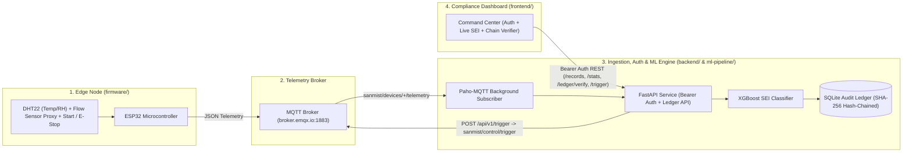

# SanMist Platform (`MistSan`)

**IoT-Enabled Automated Dry-Fog Sanitization, Regulatory Compliance Monitoring, and Machine Learning Efficacy Grading System**

[](https://www.officialgazette.gov.ph/)
[](./firmware)
[](./backend)
[](./ml-pipeline)
[](./frontend)

---

## What Is SanMist?

**SanMist (`MistSan`)** is an end-to-end IoT and Machine Learning platform designed to automate, verify, and log dry-fog sanitization in commercial food-service Back-of-House (BOH) prep areas.

In commercial kitchens, manual sanitization is difficult to standardize and audit. SanMist addresses this by connecting an **ESP32 edge controller** to a **FastAPI + XGBoost compliance engine** and an **authenticated live web dashboard**:

1. **Automate:** An ESP32 controller runs timed dry-fog misting cycles with a 1-second pre-cycle audible warning, live temperature/humidity/flow sensing, remote MQTT dispatch (`sanmist/control/trigger`), and a hardware-interrupt Emergency Stop (`E-STOP`).
2. **Stream:** Cycle telemetry is published as JSON over **MQTT** (`broker.emqx.io`) to the backend ingestion service.
3. **Evaluate:** Each cycle is scored using the evaporation-adjusted **Saturation Efficiency Index (SEI)** and graded by a **3-class XGBoost classifier** (`Pass`, `Marginal`, or `Fail`).
4. **Audit:** Results are persisted to a **SHA-256 hash-chained SQLite audit ledger** (`prev_hash` / `record_hash`) and surfaced on a Bearer-protected operational dashboard aligned with Philippine sanitation and food safety standards:
   - **Presidential Decree No. 856 (PD 856):** Code on Sanitation of the Philippines
   - **Republic Act No. 10611 (RA 10611):** Food Safety Act of 2013

---

## System Architecture



---

## Key Features

- **Automated Edge Sanitization Control:** ESP32-driven misting sequence with 1-second pre-cycle buzzer warning (`tone()` at 2 kHz), real-time flow-rate sampling (potentiometer proxy for a YF-S401 flow sensor), DHT22 ambient temperature/humidity sensing, live status heartbeat publishing (`sanmist/devices/MIST-BOH-01/status`), isolated manual cycle defaults, mid-cycle remote-trigger locking, and a hardware-interrupt Emergency Stop (`E-STOP`) safety interlock.
- **Evaporation-Adjusted SEI & ML Grading:** Evaluates each cycle across five physical parameters (`ambient_temp_c`, `relative_humidity_pct`, `flow_rate_ml_min`, `cycle_duration_sec`, `room_volume_m3`) and classifies efficacy into **Fail (`0`)**, **Marginal (`1`)**, or **Pass (`2`)** using the native XGBoost JSON model (`xgboost_sei_classifier.json`) with PD 856 threshold enforcement (`SEI >= 2.800`).
- **Dual Ingestion Modes, Deduplication & Payload Auth:** Accepts device telemetry asynchronously via MQTT (`sanmist/devices/+/telemetry`, with a 3-second deduplication window) and live sensor heartbeats (`sanmist/devices/+/status`), as well as synchronously over HTTP (`POST /api/v1/telemetry/evaluate`). Supports shared `auth_key` and HMAC-SHA256 `signature` verification across MQTT control and telemetry payloads.
- **Bearer-Token Authentication:** Protects operational endpoints (`/api/v1/records`, `/api/v1/stats`, `/api/v1/ledger/verify`, `/api/v1/trigger`, `/api/v1/auth/me`, `/api/v1/auth/logout`) using PBKDF2-SHA256 salted password hashes and timed session tokens persisted in SQLite (`users` and `auth_sessions`).
- **Tamper-Evident SHA-256 Audit Ledger:** Every row in `cycle_records` is cryptographically linked to its predecessor (`prev_hash`, starting from genesis `"0" * 64`) and sealed with a deterministic SHA-256 `record_hash` over canonical cycle fields, verifiable on demand via `GET /api/v1/ledger/verify`.
- **Command Center Dashboard UI:** Industrial compliance console with Dark/Light theme switcher, Login Overlay & demo quick-fill buttons, Live Sensor Telemetry Strip, Visual SEI Gauge, Remote Station Trigger with Live Evaporation-Adjusted SEI Preview, Pre-Dispatch Safety Confirmation Modal & active cycle countdown bar, Server-Side Pagination, Search & Status Filter Pills, SHA-256 Ledger Integrity Badge & Verify Action, expandable SHA-256 row inspector, and full filtered CSV export.

---

## Repository Structure

```text
sanmist-platform/
├── backend/
│   ├── app/
│   │   └── main.py                              # FastAPI service, Bearer auth, MQTT subscriber, ML inference & SHA-256 SQLite ledger
│   └── tests/
│       └── test_platform.py                     # Automated unit & integration tests (9 tests: auth, SEI, pagination, MQTT auth, SHA-256 chain)
├── firmware/
│   ├── src/
│   │   └── main.cpp                             # ESP32 Arduino firmware (DHT22, flow proxy, 2 kHz piezo tone, E-Stop ISR, MQTT client)
│   ├── diagram.json                             # Wokwi hardware simulation schematic
│   ├── platformio.ini                           # PlatformIO build & library configuration
│   └── wokwi.toml                               # Wokwi simulator binary mapping
├── frontend/
│   ├── index.html                               # Command Center dashboard (Vanilla JS + CSS custom properties)
│   └── tailwind.css                             # Compiled local Tailwind CSS stylesheet
├── ml-pipeline/
│   ├── datasets/
│   │   └── sanmist_telemetry_synthetic.csv      # 3,000-sample balanced synthetic BOH telemetry dataset (1,000 per class)
│   ├── models/
│   │   ├── xgboost_sei_classifier.json          # Primary native XGBoost JSON model artifact
│   │   └── xgboost_sei_classifier.pkl           # Fallback pickled XGBoost model artifact
│   ├── generate_dataset.py                      # Balanced synthetic telemetry & SEI ground-truth generator
│   └── train_model.py                           # XGBoost training & evaluation pipeline
├── mosquitto/
│   └── config/
│       └── mosquitto.conf                       # Local Eclipse Mosquitto broker configuration for Docker deployments
├── .dockerignore                                # Docker build context exclusions
├── Dockerfile                                   # Python 3.12 container image for backend and frontend services
├── docker-compose.yml                           # Multi-container orchestration (Mosquitto + FastAPI Backend + Frontend)
├── requirements.txt                             # Python runtime dependencies
└── README.md                                    # Project documentation
```

---

## Saturation Efficiency Index (SEI) & ML Classification

The platform quantifies dry-fog saturation using the evaporation-adjusted **Saturation Efficiency Index (SEI)** shared identically across `ml-pipeline/generate_dataset.py` and `backend/app/main.py`:

$$\text{evap\_loss} = (T_{\text{ambient}} - 25.0) \times 0.003 - (\text{RH} - 65.0) \times 0.001$$

$$\text{loss\_factor} = \max\big(0.85,\ \min(1.15,\ 1.0 - \text{evap\_loss})\big)$$

$$\text{SEI} = \text{round}\left(\frac{(Q_{\text{flow}} \times \text{loss\_factor}) \times \frac{t_{\text{cycle}}}{60}}{V_{\text{room}}},\ 3\right)$$

Where:
- $Q_{\text{flow}}$ = Disinfectant flow rate ($\text{mL/min}$)
- $t_{\text{cycle}}$ = Active misting cycle duration ($\text{seconds}$)
- $V_{\text{room}}$ = Target kitchen zone volume ($\text{m}^3$)
- $T_{\text{ambient}}$ = Ambient temperature ($^\circ\text{C}$)
- $\text{RH}$ = Ambient relative humidity ($\%$)

### Efficacy Classification Tiers

| Class ID | Label | SEI Threshold | Compliance Status | Description |
| :---: | :--- | :--- | :--- | :--- |
| `2` | **Pass** | $\text{SEI} \ge 2.800$ | `AUDIT VERIFIED` | Effective dry-fog saturation achieved (PD 856 / RA 10611 compliant) |
| `1` | **Marginal** | $1.800 \le \text{SEI} < 2.800$ | `REQUIRES ATTENTION` | Sub-optimal saturation; re-sanitization advised |
| `0` | **Fail** | $\text{SEI} < 1.800$ | `REQUIRES ATTENTION` | Under-saturated cycle |
| `0` | **Fail** *(E-Stop)* | `estop_triggered = true` (`SEI = 0.0`) | `SAFETY INTERLOCK TRIPPED` | Hardware emergency stop halt |

---

## Getting Started

### Prerequisites

- **Python** 3.10+ (project uses `.venv` on Windows: `.\.venv\Scripts\python.exe`)
- **PlatformIO** (installed in `.venv` as `.\.venv\Scripts\pio.exe`, or via the VS Code PlatformIO extension) & **Wokwi for VS Code** (for firmware simulation)
- A modern web browser

### 1. Set Up Python Environment

From the repository root, create and activate a virtual environment, then install dependencies from `requirements.txt`:

```powershell
python -m venv .venv
.\.venv\Scripts\Activate.ps1

.\.venv\Scripts\pip.exe install -r requirements.txt
```

### 2. Generate Dataset & Train the ML Model *(Optional)*

Pre-trained model artifacts are already committed at `ml-pipeline/models/xgboost_sei_classifier.json` (primary) and `ml-pipeline/models/xgboost_sei_classifier.pkl` (fallback). To regenerate the 3,000-sample balanced dataset and retrain the classifier:

```powershell
cd ml-pipeline
..\.venv\Scripts\python.exe generate_dataset.py
..\.venv\Scripts\python.exe train_model.py
cd ..
```

### 3. Run the FastAPI Backend & MQTT Subscriber

Start the backend server from the **repository root**:

```powershell
.\.venv\Scripts\python.exe -m uvicorn backend.app.main:app --reload --host 0.0.0.0 --port 8000
```

Once running:
- **Interactive API Docs (Swagger UI):** http://localhost:8000/docs
- **Health Check:** http://localhost:8000/
- **MQTT Listener:** Automatically subscribes to `sanmist/devices/+/telemetry` on `broker.emqx.io:1883`
- **Audit Database:** Creates, migrates, and backfills SHA-256 chains in `backend/app/sanmist_audit.db` automatically

### 4. Launch & Sign In to the Compliance Dashboard

Serve `frontend/index.html` via a local static file server:

```powershell
.\.venv\Scripts\python.exe -m http.server 3000 --directory frontend
```

Navigate to http://localhost:3000. On load, the **MistSan Command Center** Login Overlay prompts for Bearer-token authentication.

#### Default Seeded Accounts

| Role | Username | Default Password | Environment Override |
| :--- | :--- | :--- | :--- |
| Safety Administrator | `admin` | `sanmist2026` | `SANMIST_ADMIN_PASSWORD` |
| Station Operator | `operator` | `operator123` | `SANMIST_OPERATOR_PASSWORD` |

- The login modal includes **1-click Demo Credential fillers** (`Admin Demo` and `Operator Demo`) for rapid local testing.
- Sessions issue a Bearer token (`SESSION_TTL_HOURS`, default `24` hours) stored in `localStorage` under `sanmist_auth_token`. Any `401` API response automatically clears the token and returns to the Login Overlay.

#### Dashboard Controls & Features

- **KPI & Visual SEI Gauge:** Displays latest station ID, PHT (`Asia/Manila`) timestamp, XGBoost efficacy & `ml_confidence`, a 0.0–4.0+ visual SEI bar with markers at `1.800` (Marginal) and `2.800` (PD 856 Pass), and total cycle counts (`Pass`, `Marginal`, `Fail`, `E-Stop`).
- **Live Sensor Telemetry Strip:** Shows latest `Ambient Temp (°C)`, `Rel. Humidity (%)`, `Atomizer Flow (mL/min)`, and `Last Spec (Duration / Vol)`, badged as `LIVE STREAM` when receiving station heartbeats on `sanmist/devices/+/status` or `LAST CYCLE` fallback.
- **Remote Station Trigger, Live SEI Preview & Safety Modal:** Configure target `Duration (s)` (`5–300`) and `Room Size (m³)` (`0.1–200`) or select quick duration preset chips. As inputs change, the **Estimated SEI Preview** pill mirrors the backend's evaporation-adjusted SEI formula using live DHT22 temperature/humidity and flow rate when streaming (or nominal `25.0°C · 65% RH · 30.0 mL/min` fallback) and indicates `Pass (≥ 2.800)`, `Marginal (< 2.800)`, or `Fail (< 1.800)`. Clicking **Review & Start Cycle** opens a pre-dispatch safety confirmation modal requiring operator area-clear verification before sending `POST /api/v1/trigger` and starting the live countdown bar (`1s` pre-warning + misting phase).
- **Immutable Sanitization Logbook & Ledger Chain Verifier:**
  - **Integrity Badge (`#ledger-integrity-badge`):** Updates on every 3-second poll using `stats.ledger_verified` and `stats.latest_hash` (`Verified (<short-hash>)` in emerald, or `Tamper Alert!` in rose).
  - **Verify Ledger Chain Button:** Calls `GET /api/v1/ledger/verify` and renders a verification banner displaying `checked_records`, truncated `latest_hash`, and any `tampered_ids` detected.
  - **SHA-256 Hash Column & Row Inspector:** Displays a truncated `record_hash` monospace pill (`first 8…last 6` hex chars); clicking any row expands full `Record SHA-256` and `Prev SHA-256` digests with 1-click copy buttons.
  - **Server-Side Pagination, Search, Status Filter Pills & CSV Export:** Filter by station/ID/status (`All`, `Pass`, `Marginal`, `Fail`, `E-Stop`), paginate (`10`, `25`, or `50` rows per page), and export all matching filtered records across pages to CSV (including `prev_hash` and `record_hash`).

### 5. Quick Start with Docker Compose *(Optional)*

To launch the local Eclipse Mosquitto MQTT broker (`:1883`), FastAPI backend (`:8000`, with `SANMIST_MQTT_REQUIRE_AUTH=1`), and frontend server (`:3000`) in containers:

```powershell
docker compose up --build
```

### 6. Build & Simulate the ESP32 Firmware

1. Open the `firmware/` directory in VS Code with the **PlatformIO** and **Wokwi** extensions installed.
2. Build the firmware binary:
   ```powershell
   .\.venv\Scripts\pio.exe run -d firmware
   ```
3. Open `firmware/diagram.json` and start the **Wokwi Simulator** to connect to `Wokwi-GUEST` Wi-Fi and publish/receive cycle telemetry over `broker.emqx.io`.

### 7. Run the Automated Backend Test Suite

```powershell
.\.venv\Scripts\python.exe backend/tests/test_platform.py
```

Runs **9 unit and integration tests** covering unauthenticated `401` enforcement, login/session/logout lifecycle, per-cycle UTC timestamps, SEI/compliance consistency, `X-Total-Count` and `X-Filtered-Count` server-side pagination, search/status filtering, MQTT trigger & deduplication, HMAC-SHA256 / `auth_key` MQTT payload verification, SHA-256 hash-chain linkage, direct SQL tampering detection, and legacy-row backfill migration.

---

## API Reference

> Protected endpoints require an `Authorization: Bearer <access_token>` header obtained from `POST /api/v1/auth/login`.

### `GET /` *(Public)*
Returns service health, XGBoost model load status, and current MQTT broker connectivity.

```json
{
  "status": "online",
  "service": "MistSan Compliance API",
  "model_loaded": true,
  "mqtt_connected": true
}
```

### `POST /api/v1/auth/login` *(Public)*
Authenticates an operator account (`admin` or `operator`) and returns a Bearer session token.

**Request:**
```json
{
  "username": "admin",
  "password": "sanmist2026"
}
```

**Response:**
```json
{
  "access_token": "<urlsafe-token>",
  "token_type": "bearer",
  "user": {
    "username": "admin",
    "full_name": "SanMist Lead Auditor",
    "role": "Safety Administrator"
  }
}
```

### `GET /api/v1/auth/me` & `POST /api/v1/auth/logout` *(Bearer Auth Required)*
- `GET /api/v1/auth/me` returns the authenticated user's `username`, `full_name`, and `role`.
- `POST /api/v1/auth/logout` invalidates the active Bearer session token in SQLite.

### `POST /api/v1/telemetry/evaluate` *(Device / Ingestion Endpoint)*
Evaluates a sanitization cycle payload using the evaporation-adjusted SEI formula and XGBoost classifier, chains `prev_hash` and `record_hash` inside a `BEGIN IMMEDIATE` SQLite transaction, and persists the record.

**Sample Request Payload:**
```json
{
  "station_id": "MIST-BOH-01",
  "ambient_temp_c": 27.5,
  "relative_humidity_pct": 62.0,
  "flow_rate_ml_min": 42.0,
  "cycle_duration_sec": 180.0,
  "room_volume_m3": 20.0,
  "delivery_confirmed": true,
  "estop_triggered": false
}
```

**Sample Response:**
```json
{
  "duplicate": false,
  "id": 1,
  "timestamp": "2026-11-15T13:45:00.000000+00:00",
  "station_id": "MIST-BOH-01",
  "sei_score": 6.234,
  "predicted_class": 2,
  "efficacy_label": "Pass",
  "compliance_status": "AUDIT VERIFIED",
  "delivery_confirmed": true,
  "ml_confidence": 99.8,
  "estop_triggered": false,
  "prev_hash": "0000000000000000000000000000000000000000000000000000000000000000",
  "record_hash": "a3f9..."
}
```

### `GET /api/v1/records?limit=50&offset=0&status=all&search=` *(Bearer Auth Required)*
Returns paginated sanitization cycle records from `sanmist_audit.db` (ordered newest first), including `prev_hash` and `record_hash`, and sets `X-Total-Count` (all database records) and `X-Filtered-Count` (matching filtered records) response headers. Supports filtering by `status` (`all`, `pass`, `marginal`, `fail`, `e-stop`), `search` (`station_id`, `compliance_status`, or `id`), `limit` (`1–5000`), and `offset` (`>= 0`).

### `GET /api/v1/stats` *(Bearer Auth Required)*
Returns aggregate cycle breakdown counts (`total_cycles`, `pass_count`, `marginal_count`, `fail_count`, `estop_count`, `pass_rate_pct`), live hash-chain integrity fields (`ledger_verified`, `latest_hash`), broker connection status (`mqtt_connected`), and the latest station heartbeat snapshot (`live_telemetry`).

### `GET /api/v1/ledger/verify` *(Bearer Auth Required)*
Walks every row in `cycle_records` ordered by `id ASC`, checking that each row's `prev_hash` links cleanly from genesis `"0" * 64` and its `record_hash` matches the recomputed deterministic SHA-256 digest.

**Sample Response:**
```json
{
  "verified": true,
  "checked_records": 9,
  "tampered_ids": [],
  "latest_hash": "06ee591cad6bb708d5509b847a16933affc1d35a0e0d043f39a72d198ab1be1b"
}
```

### `POST /api/v1/trigger` *(Bearer Auth Required)*
Publishes an authenticated `START` command (`duration_sec`, `room_volume_m3`, `triggered_by`, `auth_key`, and HMAC-SHA256 `signature`) to `sanmist/control/trigger` over MQTT; returns HTTP `503` if the MQTT broker is disconnected or publishing fails.

---

## Project Status

This repository is an active prototype demonstrating an end-to-end IoT + ML compliance pipeline. Current prototype notes include:
- **Synthetic Training Data:** The XGBoost classifier is trained on simulated BOH telemetry (`ml-pipeline/datasets/sanmist_telemetry_synthetic.csv`) rather than field sensor logs.
- **Broker Configuration:** Local development defaults to `broker.emqx.io:1883` for Wokwi simulator compatibility, while `docker-compose.yml` provisions an isolated `eclipse-mosquitto:2` broker with `SANMIST_MQTT_REQUIRE_AUTH=1` enforcing device `auth_key` / HMAC-SHA256 signatures.
- **Hardware Simulation:** Firmware defaults (`Wokwi-GUEST` Wi-Fi and `DEFAULT_MIST_DURATION_MS = 30000`) are configured for Wokwi simulation and require physical sensor/relay calibration before production deployment.
